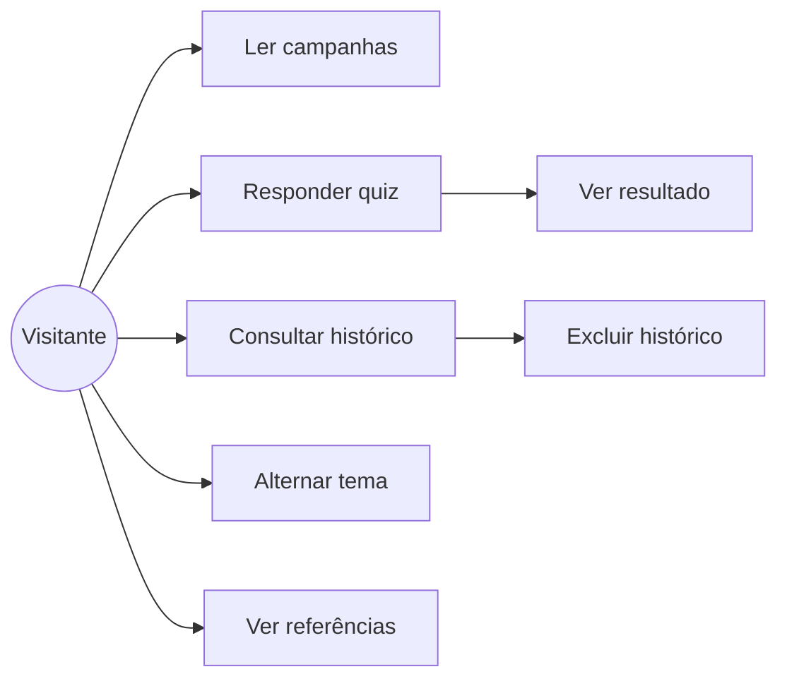

# Casos de uso
Ator: **Visitante**.
Casos: UC01 Ler conteúdo das campanhas · UC02 Responder o quiz · UC03 Ver resultado e revisão · UC04 Consultar histórico · UC05 Excluir histórico · UC06 Alternar tema · UC07 Ver referências.

