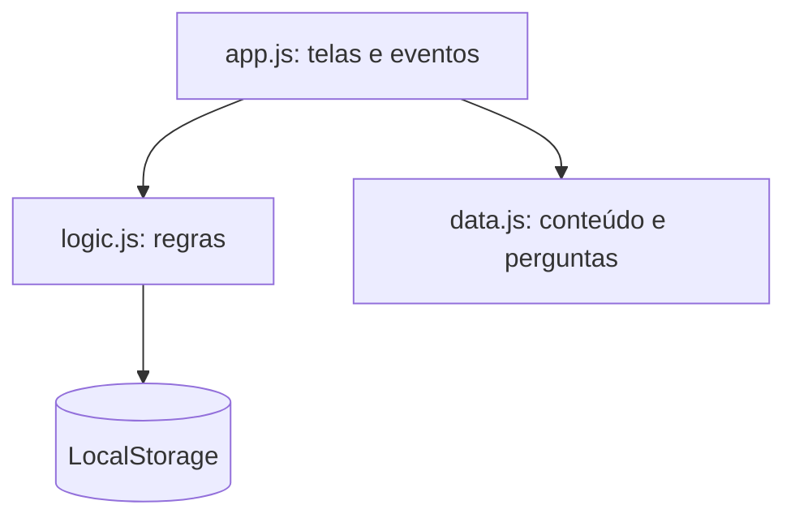
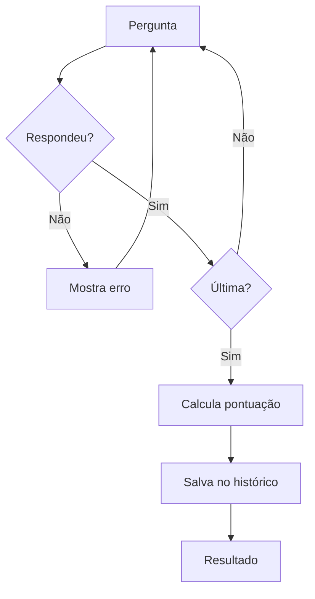
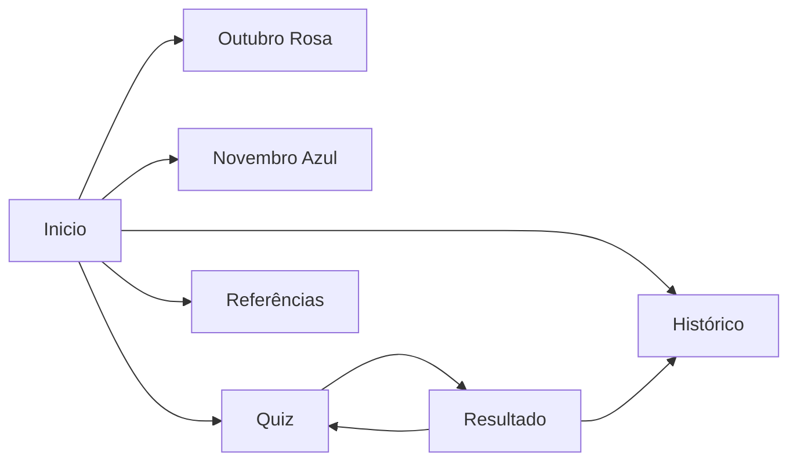

# Modelagem
**Arquitetura:** `index.html` carrega `data.js` (dados), `logic.js` (regras puras) e `app.js` (interface e rotas por hash). Persistência via LocalStorage.

## Fluxo do quiz

## Navegação

## Persistência
`vs:hist` = `[{d: ISO, hits: n, total: n}]`; `vs:theme` = `"light"|"dark"`.
